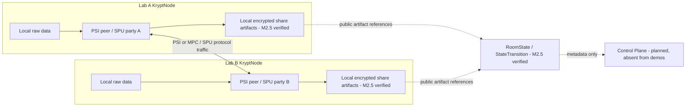

# KryptRoom

**Compute together. Reveal nothing.**

KryptRoom is a persistent encrypted state machine for collaboration between mutually distrustful organizations.

Organizations often need answers from combined data without being able to share the underlying records. KryptRoom explores how independent, organization-owned **KryptNodes** can match and join data privately, retain secret computation state, and authorize specific results. Persistent state is intended to let collaboration continue across computations and node restarts.

**Experimental research prototype.** Current protocols target two non-colluding, semi-honest participants on trusted hosts. There is no malicious-party or compromised-host protection, production KMS/HSM, key rotation, or production-grade distributed recovery/anti-rollback. The tagline expresses the privacy goal: authorized outputs such as cardinality are intentionally revealed. See the [threat model](THREAT_MODEL.md).

## What works today

- **M1 — verified two-party PSI cardinality.** Two independent processes use OpenMined PSI 2.0.6, ECDH, and the exact `Raw` container. Both peers disable matched-identifier revelation. The synthetic fixture returns intersection cardinality `2`; the [integration test](tests/integration/psi-cardinality.test.mjs) checks the result and output.
- **M2 — verified private join inside SecretFlow SPU.** Two isolated containers execute **CHEETAH / FM128**. The match mask and masked feature grids remain secret-shared, identifiers are excluded from the handoff, and a second MPC call reconstructs only cardinality. [Recorded successful Linux run](https://github.com/e-sall/KryptRoom/actions/runs/36731809790).
- **M2.5 — verified persistent encrypted RoomState.** Immutable `RoomState`, `ArtifactRef`, `StateTransition`, `StatePolicy`, `CryptoContext`, and `StateCommitment` contracts bind native SPU shares to their cryptographic context. Each KryptNode encrypts its local persisted shares with AES-256-GCM under a node-local key. In the [successful Linux CI run](https://github.com/e-sall/KryptRoom/actions/runs/38424886677), both nodes created S1, terminated, restarted without source CSV mounts, reloaded the encrypted secret state, and returned the authorized synthetic aggregate `68` through CHEETAH/FM128 without materializing a plaintext joined dataset.

These results establish behavior for the tested fixtures and stated threat model, not an independent security audit or a performance benchmark.

**M3 — verified Persistent Private Cohort Analytics.** M3 consumes S1's encrypted local SPU shares, executes COUNT, SUM, MEAN, or cross-party CROSS_MEAN, and persists secret scalar artifacts into a new S2. Computation and scalar disclosure have separate policy gates. The [successful Linux CI gate](https://github.com/e-sall/KryptRoom/actions/runs/38841137327) restarted twice, revealed only authorized `mean-a`, and rejected CROSS_MEAN before reconstruction; a separate explicitly authorized synthetic correctness case verified all six scalar outputs. See [the M3 design and validation guide](docs/PRIVATE_ANALYTICS.md).

**M4 — verified Persistent Private Neural Network.** M4 adds a fixed direct-JAX Dense 1→2→1 square-activation network over S1, persists its four secret parameter tensors as S3, and evaluates the reloaded model with S1 through an exact two-parent transition into secret MSE state S4. The [authoritative Linux run](https://github.com/e-sall/KryptRoom/actions/runs/38846097654) passed with MSE below 0.02 and no training value or model parameter reveal. See [the bounded M4 design and evidence](docs/PRIVATE_NN.md).

**M5 — VERIFIED committed state-transition proof.** [Authoritative GitHub Actions](https://github.com/e-sall/KryptRoom/actions/runs/38922127315) generated and independently verified a real SP1 6.9.0 CPU Groth16 proof, exercised the invalid-relation and public-tampering negatives, deleted the witness, and passed the no-secret-payload/leakage checks. See [the M5 validation report](docs/M5_VALIDATION.md).

**M6 — verified persistent FHE state transition.** M6 persists two exact OpenFHE BGV-RNS ciphertext vectors as `S5_fhe_inputs`, reloads them in a secret-key-free evaluator, applies exactly one `EvalAdd`, and persists the child ciphertext as `S6_fhe_sum`. Lab A alone owns the private key; computation and the later Lab A/Lab B reveal are separate authorizations. The [authoritative Linux run](https://github.com/e-sall/KryptRoom/actions/runs/39155437292) reloaded real ciphertexts, produced `[16, 22, 26, 34]`, rejected unauthorized operations/reveals and tampering, and passed without persisting plaintext intermediates or placing the private key in the Control Plane. See [the M6 design, evidence, and limitations](docs/FHE_STATE_TRANSITION.md).

**M7 — public-chain anchor implemented; live validation pending.** M7 adds a
stateless event-only Solidity contract, exact domain-separated commitments,
immutable off-chain inclusion records, Base `safe`/`finalized` and reorg checks,
and a standalone three-layer verifier. The only KryptRoom value published
on-chain is `bytes32 AnchorCommitment`; state/proof material remains off-chain.
No Base Sepolia deployment or transaction is claimed until the protected
testnet environment is available. See [the M7 protocol and limits](docs/PUBLIC_CHAIN_ANCHOR.md).

## Hero use case: cancer-research collaboration

KryptRoom can generate an independently verifiable zero-knowledge proof that a
committed model-evaluation state transition is consistent with its committed
lineage, artifact bindings, authorization policy, cryptographic context, and
child-state commitment without exposing the underlying collaborative data.

The M5 proof does not prove correctness of the underlying SecretFlow/CHEETAH
computation or the numerical evaluation result. It does not establish participant
cryptographic approval/signatures or malicious security. See
[scope and validation](docs/STATE_PROOF.md).

Lab A holds genomic features; Lab B holds clinical treatment-response information for an overlapping population. Each lab wants to study the overlap without handing patient identifiers or raw records to the other lab or a central operator.

The repository uses only small synthetic fixtures. M1 privately counts the overlap. M2 independently compares identifiers inside MPC and creates a secret-shared join; M1 does not export hidden matches into M2. The persistence layer is intended to keep that join available for later authorized computations.

```text
Private Matching → Private Join → Persistent State → Analytics / ML → Proof → FHE Transition → Public Anchor
M1 verified        M2 verified    M2.5 verified       M3/M4 verified    M5 verified   M6 verified       M7 live pending
```

The M2.5 aggregate is a narrow continuity test, not the general M3 analytics API. M4 is runtime-verified only for one deterministic bounded synthetic training/evaluation fixture. M5 is verified only for its bounded committed metadata relation and does not prove the SecretFlow/CHEETAH or numerical computation. M6 is runtime-verified only for exact four-element BGV ciphertext addition. M7 is not live-chain verified and does not prove any underlying computation. No real patient data, biomedical performance claim, arbitrary FHE analytics, or ZK proof of FHE arithmetic is included.

## Architecture



Raw data is read locally by its owner. The M2 handoff stays secret-shared across both nodes; the M2.5 code additionally encrypts each persisted local share at rest. Public state metadata describes policy, parentage, crypto context, and ciphertext commitments. The Control Plane is a future metadata coordinator and receives no raw datasets in the current demos because it is absent from their data path.

The fixed-shape join takes O(n×m) work and targets small, public capacities. AES-GCM at-rest encryption is separate from MPC confidentiality. State commitments are unsigned SHA-256 hashes, not proofs or signatures. Details: [architecture](ARCHITECTURE.md), [decisions](docs/DECISIONS.md), [runtime notes](engines/mpc/README.md).

## Run the synthetic demos

Use Node.js 22 (the CI version) and npm for PSI and the local test suite:

```bash
npm ci --ignore-scripts
npm test
npm run demo:psi
```

The PSI package includes precompiled WebAssembly. `--ignore-scripts` avoids an unnecessary dependency installer; it does not replace the cryptographic runtime.

M2 requires Linux containers and Docker Compose:

```bash
docker compose -f compose.private-join.yml up --abort-on-container-failure
docker compose -f compose.private-join.yml down
```

SecretFlow 1.14.0b0 is pinned by immutable image digest. The reviewed runtime uses its no-Ray production scheduler with CHEETAH/FM128. Its Python environment remains inside the container.

To exercise the verified M2.5 acceptance path:

```bash
docker compose -f compose.persistent-state.yml -f compose.persistent-state.persist.yml up --abort-on-container-failure
docker compose -f compose.persistent-state.yml -f compose.persistent-state.persist.yml down
docker compose -f compose.persistent-state.yml up --abort-on-container-failure
docker compose -f compose.persistent-state.yml down
```

The expected post-restart aggregate is `68`. The second phase has no source CSV mounts. State lives under ignored `.runtime/persistent-state/`; existing S1 files cannot be overwritten through the storage API. Keep these files and their keys private. Losing a node's key/share makes this demo state unrecoverable; there is no automated recovery procedure.

M6 uses the official Ubuntu 24.04 OpenFHE Python wheel and therefore runs on
Linux with Python 3.12. Its authoritative command is:

```bash
python -m pip install -r tests/fhe_state_transition/requirements.txt
python -m pip install --require-hashes -r tests/fhe_state_transition/requirements-openfhe.txt
python tests/fhe_state_transition/run_integration.py
```

The test creates all keys and ciphertexts in a temporary ignored directory and
uploads none of them. It must not be run with production participant data or
production keys.

M7 contract and off-chain checks are local and do not need a wallet:

```bash
cd chain/contracts
forge fmt --check
forge build --sizes
forge test -vvv
cd ../..
python -m pip install -r tests/chain_anchor/requirements.txt
python -m unittest discover -s tests/chain_anchor -p 'test_*.py' -v
python tests/chain_anchor/generate_vectors.py
git diff --exit-code -- tests/chain_anchor/fixtures
```

The manual live-acceptance workflow is intentionally gated by the protected
`base-sepolia-m7` environment. Do not dispatch it until the limited testnet RPC
and wallet secrets are configured and the authoritative deployment records can
be reviewed and committed. Local success is not live-chain verification.

## Security model

The protocols assume participants follow the reviewed code. Matched identifiers are disclosed to neither participant by the authorized interfaces; future identifier disclosure requires explicit opt-in. Cardinality and other explicitly authorized aggregates can still reveal information through small or repeated queries. Public capacities, tensor shapes, and protocol traffic also disclose metadata.

Peer authentication, malicious security, host compromise resistance, signed state commitments, production key custody, anti-rollback, and distributed recovery are not implemented. The demos have no production deployment approval or independent security audit and must not be used with real medical or regulated data. See [SECURITY.md](SECURITY.md) and [THREAT_MODEL.md](THREAT_MODEL.md).

## Roadmap and repository guide

M3 analytics, M4 persistent private NN training/evaluation, the bounded M5 committed state-transition proof, and M6's narrow FHE transition are verified on their synthetic fixtures. M7 is implemented with live Base Sepolia validation pending. Later work remains unimplemented. See the [ordered roadmap](docs/ROADMAP.md) and [milestone checklist](TODO.md).

- `nodes/krypt-node/`: participant PSI processes and local input boundary.
- `engines/mpc/`: verified SPU join and persistent encrypted RoomState implementation.
- `packages/manifests/`: job, policy, and RoomState schemas.
- `demos/cancer-collaboration/`: synthetic fixtures and manifests.
- `tests/` and `.github/workflows/`: integration, privacy, and reproducibility checks.
- `engines/fhe/`: bounded M6 OpenFHE state-transition adapter and reveal boundary.
- `engines/zk/`: verified bounded M5 SP1 6.9.0 CPU Groth16 metadata-proof implementation.
- `chain/`: M7 Foundry contract and deployment/recording helpers; no live deployment manifest yet.
- `services/` and `apps/`: future component placeholders.

[Project context](PROJECT_CONTEXT.md) preserves technical direction. [CONTRIBUTING.md](CONTRIBUTING.md) describes the review and evidence expectations.

## License status

No project license has been selected. Public visibility does not by itself grant a general reuse license; dependency licenses remain their own. A license decision will be made explicitly before encouraging downstream adoption.

